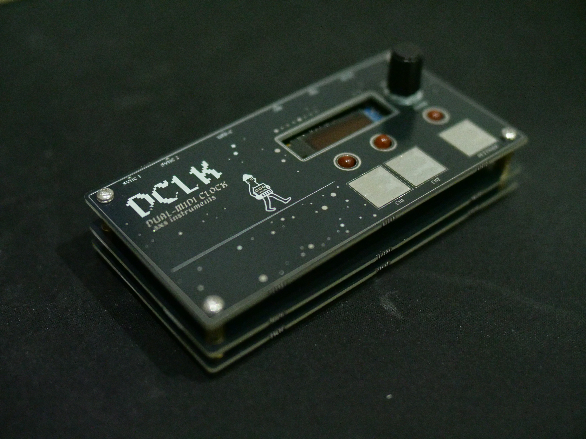

# DCLK — Dual MIDI Clock



**.axs instruments** · Firmware v1.6.3 · Hardware v1.0

DCLK is a dual MIDI clock built around an STM32F411 Black Pill. It sends
MIDI clock to two TRS (Type A) outputs and over USB MIDI, with quantised
start/stop and a separate clock divider for each output, so two machines can
be dropped in and out of a jam on the bar.

## Update the firmware

### ➜ [DCLK Web Flasher & Editor](https://joebmz98.github.io/DCLK-Flasher/)

Flash the latest release straight from Chrome or Edge on a computer. No
software to install. Your saved settings are kept. Flasher source:
[DCLK-Flasher](https://github.com/joebmz98/DCLK-Flasher).

1. Plug DCLK into the computer with a USB‑C data cable.
2. Put DCLK into update mode: click **Enter update mode** on the flasher,
   or choose **Settings > UPDATE** and push the encoder. The screen shows
   **DFU READY**. (Firmware 1.5 and later. On older firmware, or if DCLK
   won't start: hold **BOOT0**, tap **NRST**, keep holding BOOT0 for about a
   second. The screen and LEDs stay off in that mode.)
3. Click **Flash Firmware** and choose **STM32 BOOTLOADER**.

Windows needs a one-time WinUSB driver (Zadig); the flasher's Troubleshooting
section walks through it.

## Features

- Tempo from 30 to 300 BPM, set with the encoder (24 PPQN)
- Two TRS Type A MIDI outputs plus USB MIDI (class compliant, shows up as
  **DCLK**, no drivers)
- Quantised start: outputs wait for the next bar boundary of the wait length
  (1, 2, 4, 8 or 16 bars) before sending Start
- Optional quantised stop, landing on the same boundary
- Per-output clock divide: /1 /2 /3 /4 /6 /8
- USB MIDI clock follows either output
- Two 5 V analogue sync outputs (3.5 mm TRS): clock pulse on the tip
  (1, 2, 4, 8, 12 or 24 PPQN per output, default 24, after the channel's
  divider), run gate on the ring. SYNC 1 follows CH1, SYNC 2 follows CH2
  (firmware 1.6 and later; PPQN setting from 1.6.1)
- Screen saver: dims while a clock runs, switches off when stopped, with a
  slow breathing BEAT LED in standby
- Capacitive touch buttons (CAP1206) for CH1, CH2 and Settings
- Settings saved to flash and kept across power cycles and firmware updates

## Using DCLK

| Control | Action |
| --- | --- |
| Encoder (main screen) | Set tempo |
| **CH1** / **CH2** | Start or stop that output. Press again while waiting to cancel |
| **Settings** | Open the menu · back · cancel an edit |
| Encoder push | Select / confirm in the menu |

Clock, Start and Stop are MIDI System Real-Time messages, so they carry no
MIDI channel: "CH1" and "CH2" mean the two output jacks.

**LEDs**

- **CH1 / CH2:** solid while running, slow fade while waiting to start, blink
  on the beat while waiting for a quantised stop, off when stopped.
- **BEAT:** flashes on every beat.

**Main screen:** a white CH1 / CH2 tab appears along the top while that
output plays, and disappears when it stops (firmware 1.6.2 and later). Below them
are the tempo and four beat bars; the current beat stands taller. The bars
and the BEAT LED move while an output plays, and (from 1.6.3) while a USB
host plays in HOST mode even with both outputs off.

**Menus**

| Menu | Settings |
| --- | --- |
| LEDS | Brightness: LO / MID / HI |
| MIDI | WAIT LEN · STOP Q · CH1 DIV · CH2 DIV · USB OUT |
| SYNC | SYNC 1 / SYNC 2 pulses per quarter note: 1 / 2 / 4 / 8 / 12 / 24 |
| SCREEN | SAVER: OFF / 1 / 5 / 10 / 30 min |
| MONITOR | USB and clock diagnostics; encoder push toggles a USB test note (C4, ch 1) |
| UPDATE | Restart into DFU mode for the web flasher (push the encoder to confirm, SETTINGS cancels) |
| ABOUT | Product, maker and firmware version |

## Connections

| Connector | Use |
| --- | --- |
| USB‑C (Black Pill) | USB MIDI clock, power, firmware updates |
| MIDI OUT 1 / 2 | 3.5 mm TRS, Type A |
| SYNC OUT 1 / 2 | 3.5 mm TRS, 5 V: tip = clock pulse, ring = run gate (high while playing) |
| DC jack | 5 V, centre positive |

## Hardware

KiCad 9 project in `build/DCLK-MIDI-Clock/`, with JLCPCB-ready Gerbers,
BOM and placement files in `production/`. Custom footprints are in
`lib/DCLK.pretty/`.

Main parts: STM32F411CEU6 Black Pill, SSD1306 128×32 I²C OLED, CAP1206
touch controller, Alps EC11E encoder with switch, 2× CUI SJ1‑3525N TRS jacks,
GCT DCJ200 DC jack, 3× 5 mm LEDs.

| Function | Pin |
| --- | --- |
| MIDI OUT 1 / 2 (TX) | PA9 (USART1) / PA2 (USART2) |
| SYNC 1 clock / run | PA8 / PB15 (via 74AHCT125 to 5 V) |
| SYNC 2 clock / run | PA5 / PA4 (via 74AHCT125 to 5 V) |
| CH1 / CH2 / Settings touch pads | CAP1206 CS1 / CS2 / CS3 (I²C 0x28) |
| CAP1206 ALERT# | PB12 |
| Encoder A / B / push | PB4 / PB5 / PB13 |
| LED CH1 / CH2 / BEAT | PB8 / PB9 / PA6 (PWM) |
| OLED + CAP1206 SDA / SCL | PB7 / PB6 |

## Building the firmware

The sketch is `src/dclk_midi_clock/dclk_midi_clock.ino` (Arduino IDE).

- **Core:** STM32duino with the custom board entry
  **DCLK Dual MIDI Clock**, which gives a clean 48 MHz USB clock from the
  Black Pill's 25 MHz crystal. The sketch warns at compile time if another
  board is selected.
- **Board options:** USB support *None* (TinyUSB provides USB) · U(S)ART
  support *Enabled (generic 'Serial')*.
- **Libraries:** Adafruit GFX, Adafruit SSD1306, Adafruit TinyUSB.
- **Upload method:** STM32CubeProgrammer (DFU or SWD). The image must be
  linked at `0x08000000`, with no HID or UF2 bootloader offset.

To publish a release, use **Sketch > Export Compiled Binary**, copy the
`.hex` into the flasher repo's `firmware/` folder and update its
`manifest.json`.

## Repository layout

```
src/dclk_midi_clock/   firmware sketch, compiled builds, font
legacy/                every firmware release (hex, bin, source)
build/DCLK-MIDI-Clock/ KiCad project and production files
lib/DCLK.pretty/       custom footprints
assets/                artwork (polarity marking)
```

## License

MIT. See [LICENSE](LICENSE). © 2026 .axs instruments
